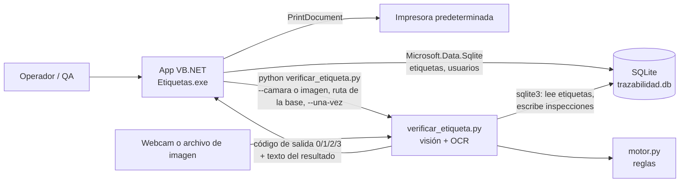

# Manual técnico — Etiquetas de trazabilidad

Manual de instalación y mantenimiento para quien instala, configura o modifica el sistema. Describe el código tal como está en la rama `main` después de las correcciones finales.

## Contenido

1. [Descripción general](#1-descripción-general)
2. [Estructura del repositorio](#2-estructura-del-repositorio)
3. [Requisitos](#3-requisitos)
4. [Instalación](#4-instalación)
5. [Configuración de la estación](#5-configuración-de-la-estación)
6. [Arquitectura de la app VB.NET](#6-arquitectura-de-la-app-vbnet)
7. [Base de datos](#7-base-de-datos)
8. [Módulo de visión](#8-módulo-de-visión)
9. [Motor de inferencia](#9-motor-de-inferencia)
10. [Pruebas](#10-pruebas)
11. [Mantenimiento](#11-mantenimiento)
12. [Problemas conocidos y trabajo futuro](#12-problemas-conocidos-y-trabajo-futuro)
13. [Solución de problemas](#13-solución-de-problemas)

---

## 1. Descripción general

El sistema tiene dos partes que comparten una base de datos SQLite:

- **App de escritorio VB.NET** (Windows Forms, .NET 8, ensamblado `Etiquetas`). Imprime las etiquetas de trazabilidad y genera su serial, registra cada etiqueta, permite a QA liberarla o rechazarla, administra los usuarios de QA e imprime etiquetas de embarque.
- **Módulo Python de visión y reglas** (`EtiquetasV4/OCR/`). Lee una etiqueta impresa con la cámara o desde una imagen (códigos de barras Code 39 + OCR), la compara con el registro y un motor de reglas decide LIBERAR, RECHAZAR o REVISIÓN MANUAL con su explicación.

La app ejecuta el script de Python como proceso externo, una vez por verificación, y lee su código de salida. La verificación es solo una recomendación: Python escribe una fila en `inspecciones` pero **nunca cambia el estado de la etiqueta**. La liberación siempre la hace QA en la app.



---

## 2. Estructura del repositorio

```
trazabilidad-inteligente/
  EtiquetasV4.sln              solución de Visual Studio (un solo proyecto)
  CLAUDE.md                    notas del código para asistentes de programación
  db/
    schema.sql                 única fuente del esquema; se embebe en el ensamblado
  docs/
    PLAN.md                    plan por fases y lo que se construyó
    indice-manuales.md         índice acordado de los manuales
    manual-usuario.md          manual de operador y QA
    manual-tecnico.md          este manual
    img/                       capturas de pantalla de los manuales
  Img/                         logo e ícono (Logo.png, icon2.png)
  EtiquetasV4/
    Etiquetas.vbproj           proyecto VB (net8.0-windows)
    Form1.vb (+ .Designer.vb)  ventana principal: Traceability y Release, casi toda la lógica
    Liberacion.vb              diálogo de inicio de sesión de QA
    Registro.vb                diálogo de alta de usuarios
    Embarques.vb               formulario de etiqueta de embarque (estación EMBARQUES)
    BaseSqlite.vb              acceso a la base: etiquetas, liberación/rechazo, usuarios
    CodigoBarras39.vb          dibuja los códigos de barras Code 39 con rectángulos (sin fuente)
    VerificadorOCR.vb          ejecuta el script de Python y traduce su código de salida
    VentanaResultadoOCR.vb     ventana del resultado (creada por código, sin diseñador)
    ApplicationEvents.vb       plantilla de eventos de la aplicación (vacía)
    Etiquetas/                 configuración de la estación: Area.txt, Spot.txt, No_borrar_ni_abrir.txt
    OCR/
      verificar_etiqueta.py    visión: preprocesamiento, Code 39, OCR, nitidez, bitácora
      motor.py                 motor de inferencia (reglas y decisión)
      test_motor.py            pruebas del motor (unittest)
    My Project/
      Application.myapp        formulario de inicio: Form1
      PublishProfiles/         perfiles de publicación (carpeta y ClickOnce)
    Resources/Logo.png         logo de la barra superior
  datos/                       (no se versiona) trazabilidad.db y capturas/
```

`bin/`, `obj/`, `.vs/`, `*.user`, `datos/` y los archivos `.db` están en `.gitignore`.

---

## 3. Requisitos

| Componente | Para qué | Notas |
|---|---|---|
| **Windows** | App WinForms | La app usa `net8.0-windows` y llamadas a `Gdi32.dll` |
| **.NET 8 Desktop Runtime** | Ejecutar la app publicada | Para desarrollo: **.NET 8 SDK** (`dotnet build`, `dotnet run`) |
| **Fuente "Bar-Code 39"** | Códigos de barras de la etiqueta de embarque | Solo en estaciones EMBARQUES. Las etiquetas de trazabilidad y de liberación no necesitan ninguna fuente de código de barras (ver [6.7](#67-códigos-de-barras-codigobarras39)) |
| **Impresora** | Imprimir | La app imprime siempre en la **impresora predeterminada de Windows**, sin diálogo |
| **Python 3** en el `PATH` como `python` | Verificación OCR | `VerificadorOCR.vb` ejecuta literalmente `python`. Las pruebas se corrieron con Python 3.13 |
| `opencv-python`, `pyzbar`, `pytesseract` | Visión, códigos de barras, OCR | `pip install opencv-python pyzbar pytesseract` |
| **Tesseract OCR para Windows** | Motor de OCR | Instalador de UB Mannheim. Se busca en el `PATH` o en `C:\Program Files\Tesseract-OCR` / `C:\Program Files (x86)\Tesseract-OCR` |
| **Visual C++ Redistributable** | La DLL de zbar que trae `pyzbar` | Si `import pyzbar.pyzbar` falla con un error de DLL, instalar el de Visual Studio 2013 |
| **Webcam** | Verificación con cámara | Se usa siempre la cámara 0 (`cv2.VideoCapture(0)`) |

Las pruebas del motor (`test_motor.py`) no necesitan OpenCV, Tesseract, cámara ni base de datos.

---

## 4. Instalación

### 4.1 Desarrollo

```
git clone https://github.com/Yuupwp/trazabilidad-inteligente.git
cd trazabilidad-inteligente
dotnet build EtiquetasV4.sln
dotnet run --project EtiquetasV4/Etiquetas.vbproj
```

Al compilar se copian a la carpeta de salida (`EtiquetasV4\bin\Debug\net8.0-windows\`):
- `Etiquetas\*.txt` (configuración de la estación),
- `OCR\*.py` (módulo de Python).

`db/schema.sql` se embebe en el ensamblado como recurso `schema.sql`.

Al ejecutar desde el repositorio, la base se crea en `<repo>\datos\trazabilidad.db` (ver [5.4](#54-ubicación-de-la-base-de-datos-traza_db)).

También se puede abrir `EtiquetasV4.sln` en Visual Studio 2022.

### 4.2 Producción

1. Publicar con el perfil de carpeta:
   ```
   dotnet publish EtiquetasV4/Etiquetas.vbproj -p:PublishProfile=FolderProfile
   ```
   El resultado queda en `EtiquetasV4\bin\Release\ActualizacionEtiquetas\` (dependiente del runtime, no autocontenido).
2. Copiar **toda** esa carpeta a la estación. Debe incluir `Etiquetas.exe`, sus DLL, la carpeta `Etiquetas\` y la carpeta `OCR\`.
3. Editar `Etiquetas\Area.txt` y `Etiquetas\Spot.txt` para esa estación (ver [sección 5](#5-configuración-de-la-estación)).
4. Instalar en la estación el .NET 8 Desktop Runtime (y la fuente Bar-Code 39 si es EMBARQUES) y configurar la impresora de etiquetas como predeterminada.
5. Fuera del repositorio, la base se crea en `<carpeta del exe>\datos\trazabilidad.db`, salvo que se defina `TRAZA_DB`.

> **Al actualizar una estación**, no sobrescribas `Etiquetas\` ni `datos\`. La publicación trae los `.txt` del repositorio, que reemplazarían el área, el spot y el contador individual de la estación, y `datos\` contiene la base.

Los perfiles `ClickOnceProfile*.pubxml` vienen del sistema original y apuntan a una carpeta compartida de su red. Con ClickOnce la carpeta de instalación cambia en cada versión, así que la base y el contador quedarían atrás. Si se usa, definir `TRAZA_DB` con una ruta fija.

### 4.3 Python y OCR

1. Instalar Python 3 y marcar *Add python.exe to PATH*.
2. Instalar las librerías:
   ```
   pip install opencv-python pyzbar pytesseract
   ```
3. Instalar Tesseract OCR para Windows (instalador de UB Mannheim) en la ruta por defecto, o agregar su carpeta al `PATH`.

Verificación:

```
python --version
python -c "import cv2, pyzbar.pyzbar, pytesseract; print(pytesseract.get_tesseract_version())"
cd EtiquetasV4\OCR
python -m unittest test_motor -v
python verificar_etiqueta.py <foto_de_etiqueta.png> <ruta\trazabilidad.db>
```

La segunda línea debe imprimir la versión de Tesseract sin errores. La última debe imprimir el bloque de resultado (ver [8.6](#86-uso-por-línea-de-comandos)).

---

## 5. Configuración de la estación

Los archivos están en `EtiquetasV4\Etiquetas\` y se leen desde `AppContext.BaseDirectory\Etiquetas\` (la carpeta del ejecutable).

### 5.1 `Area.txt`

Nombre del área y modo de la estación. Se muestra en la barra superior y se guarda en `etiquetas.area`.

| Contenido | Modo |
|---|---|
| `PIPING` | Muestra el campo *Revision*. La revisión se imprime como `Rv` y se guarda en `revision` |
| `EMBARQUES` | Oculta la trazabilidad y carga el formulario `Embarques` dentro de `panelTrazabilidad` |
| Cualquier otro texto | Estación normal |

La comparación ignora mayúsculas, pero **no recorta espacios ni saltos de línea**: el archivo debe contener solo la palabra, sin línea nueva al final. Si `Area.txt` no existe, la app falla al iniciar.

### 5.2 `Spot.txt`

Nombre del puesto. Se guarda en `etiquetas.spot`. Si falta, la app avisa *"El archivo Spot.txt no existe."* y sigue sin spot.

### 5.3 `No_borrar_ni_abrir.txt`

Contador individual de la estación (un entero). Se muestra en *Individual* y se guarda en `consecutivo_individual`. La app lo reescribe en cada impresión. Si no existe, empieza en 0 y se crea al imprimir. Si no contiene un entero, la app avisa *"No se pudo recuperar el valor de etiquetaActual desde el archivo."*

### 5.4 Ubicación de la base de datos (`TRAZA_DB`)

`BaseSqlite.RutaBase` se resuelve una vez, en este orden:

1. Variable de entorno **`TRAZA_DB`** con la ruta completa del archivo `.db`.
2. `<raíz del repositorio>\datos\trazabilidad.db`. La raíz se encuentra buscando `EtiquetasV4.sln` hacia arriba desde la carpeta del ejecutable.
3. `<carpeta del ejecutable>\datos\trazabilidad.db`.

La carpeta se crea si no existe y el esquema se aplica en la primera conexión. Las capturas de la cámara se guardan en `capturas\`, junto a la base. La app pasa la misma ruta al script de Python.

Para fijar la ruta en una estación (PowerShell, para el usuario actual):

```
[Environment]::SetEnvironmentVariable("TRAZA_DB", "D:\Trazabilidad\trazabilidad.db", "User")
```

Hay que reiniciar la app para que la tome.

### 5.5 Primer usuario de QA

Los usuarios viven en la tabla `usuarios`. Si está vacía:
- **Register** muestra *"No hay usuarios registrados. Crea el primer usuario de QA."* y abre `Registro` sin pedir inicio de sesión.
- **Release** muestra *"No hay usuarios registrados. Crea el primero con el botón Register."* y no entra.

Con al menos un usuario, *Register* pide iniciar sesión con un usuario existente antes de abrir `Registro`.

---

## 6. Arquitectura de la app VB.NET

### 6.1 Formularios y módulos

| Archivo | Tipo | Función |
|---|---|---|
| `Form1` | Formulario principal (`MainForm` en `Application.myapp`) | Barra superior, botones de navegación, panel de trazabilidad, panel de liberación, botón OCR |
| `Liberacion` | Diálogo | Inicio de sesión; devuelve `DialogResult.OK` si `ValidarUsuario` es verdadero |
| `Registro` | Diálogo | Alta de usuario (usuario y contraseña de 3 a 8 caracteres) |
| `Embarques` | Formulario incrustado | Etiqueta de embarque; solo en modo EMBARQUES; no usa la base |
| `VentanaResultadoOCR` | Formulario creado por código | Resultado de la verificación con encabezado de color |
| `BaseSqlite` | Módulo | Único acceso a SQLite desde VB |
| `CodigoBarras39` | Módulo | Dibuja códigos Code 39 con rectángulos ([6.7](#67-códigos-de-barras-codigobarras39)) |
| `VerificadorOCR` | Módulo | Ejecuta Python y traduce el código de salida |

`Form1` no tiene borde (`FormBorderStyle.None`), redondea sus esquinas con `CreateRoundRectRgn` y se arrastra desde el panel `Ventana`.

**Paneles.** `panelTrazabilidad` (x = 0) y `panelLiberacion` (x = 599, fuera de la ventana de 581 px) no se muestran ni se ocultan: `IntercambiarPosiciones` intercambia sus ubicaciones. *Release* lo hace solo si el login devuelve OK. *Traceability* lo hace sin login. Volver a *Release* vuelve a pedir el login.

**Botón OCR.** `AgregarBotonVerificacion` crea por código el botón *Verify label (OCR)* (anclado abajo a la derecha) para no tocar el diseñador.

**Controles principales** (nombres del diseñador):

| Pantalla | Control | Etiqueta en pantalla | Uso |
|---|---|---|---|
| Traceability | `TextBox1` | WorkOrder | `wo` |
| | `TextBox11` | Add item | `item`; también el código de barras M/I |
| | `TextBox4` | Initials Supervisor | `supervisor` (SV) |
| | `TextBox5` | Identification number | `no_id` |
| | `ComboBox2` | Shift | `turno` (1–5) |
| | `TextBox10` | Number of copies | número de etiquetas; `copias` |
| | `TextBox2` | Revision | `revision` (solo PIPING) |
| | `TextBox13` | No. of Reprints | reimpresiones |
| | `TextBox12` / `TextBox14` | Individual / Global | contadores (solo lectura) |
| | `Button3` / `Reimprimir` | Print / Reprint | |
| | `TextBox8`, `TextBox3` | (ocultos) | Solo guardan fuentes de texto: `TextBox8` = Segoe UI 10 pt, `TextBox3` = Segoe UI 10.2 pt negrita |
| | `TextBox7` | (oculto) | Resto de la versión con fuente: conserva Libre Barcode 39 24 pt y recibe `*item*`, pero ya no se usa para dibujar |
| Release | `Serial_SQL` / `Buscar` | Serial / Search | |
| | `WorkOrder_SQL`, `Item_SQL` | WorkOrder, Item | deshabilitados; los llena Search |
| | `modeloFinal_SQL` | Model final | `modelo_final` |
| | `Liberado` | Released by: | `liberado_por` |
| | `Turno` | Shift | solo se imprime |
| | `Cantidad` | Numer of copies | copias de la etiqueta de liberación |
| | `Reimpirmir` | No. of Reprints | |
| | `ImprimirQA` / `ReimpresionQA` / `RechazarQA` | Print / Reprint / Reject | |

### 6.2 Flujo de impresión de trazabilidad

`Button3_Click` (Print):
1. Valida que *Add item* y *Number of copies* no estén vacíos y que *Number of copies* sea entero.
2. Guarda los campos en variables `temp*` (para Reprint).
3. Llama `PrintDocument1.Print()` **una vez por copia**.
4. Limpia los campos.

`PrintDocument1_PrintPage` (se ejecuta en cada `Print()`):
1. Toma `DateTime.Now` (fecha del serial y de la etiqueta).
2. Lee `etiquetaGeneral = BaseSqlite.MaxConsecutivoGlobal()` (`MAX(consecutivo_global)` o 0).
3. Calcula la letra del mes (`A`–`H`, `J`–`M`).
4. Incrementa el contador individual (`etiquetaActual`) y el global.
5. Arma el serial: `"R" & yy & letra & "S" & etiquetaGeneral.ToString("000000")`.
6. Dibuja la etiqueta con coordenadas fijas. Los códigos de barras (SN en `(70, 66)` y M/I en `(75, 14)`, tomado de `TextBox11`) se dibujan con `CodigoBarras39.Dibujar` ([6.7](#67-códigos-de-barras-codigobarras39)).
7. Escribe el contador individual en `No_borrar_ni_abrir.txt`.
8. Inserta la fila con `BaseSqlite.Insertar` (estado `IMPRESA`).

Consecuencias:
- *Number of copies* = N produce **N etiquetas distintas**, cada una con su serial y su fila.
- El consecutivo global nunca se reinicia. El bloque `mesAnterior` que lo pone en 0 es código muerto: el paso 2 lo sobrescribe.
- Si el `INSERT` falla, la etiqueta ya se dibujó y se imprime sin registro.

`Button4_Click` (Reprint) restaura los campos `temp*` y vuelve a llamar `PrintDocument1.Print()`. Pasa por el mismo `PrintPage`, así que **cada reimpresión crea un serial y una fila nuevos**. Ver los detalles en [12](#12-problemas-conocidos-y-trabajo-futuro).

### 6.3 Flujo de liberación

| Acción | Método | Qué hace |
|---|---|---|
| Search | `Buscar_Click` | `BuscarPorSerial` llena WO e Item. Si `estado <> 'IMPRESA'`, avisa |
| Print | `ImprimirQA_Click` | Valida campos y copias ≥ 1. **Primero** `BaseSqlite.Liberar`; si no devuelve `Hecho`, avisa y no imprime. Después guarda `temp*` e imprime N copias con `PrintDocument2` |
| Reprint | `ReimpresionQA_Click` | Reimprime con los `temp*` de la última liberación de la sesión. No toca la base |
| Reject | `RechazarQA_Click` | Exige serial y *Released by*, pide confirmación y llama `BaseSqlite.Rechazar`. No imprime |

`PrintDocument2_PrintPage` solo dibuja la etiqueta "Calidad Liberacion" (WO, Item, Modelo final, fecha y hora, Turno, Liberado por, serial en barras y en texto). El código del serial se dibuja con `CodigoBarras39.Dibujar` en `(80, 101)`.

### 6.4 `BaseSqlite`

| Función | Descripción |
|---|---|
| `RutaBase` | Ruta resuelta de la base ([5.4](#54-ubicación-de-la-base-de-datos-traza_db)) |
| `Abrir()` (privada) | La primera vez: crea la carpeta, abre en `ReadWriteCreate` y ejecuta `schema.sql` completo. Después abre una conexión nueva por llamada |
| `MaxConsecutivoGlobal()` | `SELECT COALESCE(MAX(consecutivo_global), 0)` |
| `Insertar(...)` | Inserta una etiqueta. El serial se guarda en mayúsculas. Los textos vacíos se guardan como `NULL` (excepto `area`, `wo`, `item`, que son `NOT NULL` y quedan como cadena vacía) |
| `BuscarPorSerial(serial, wo, item, estado)` | Busca sin distinguir mayúsculas (`COLLATE NOCASE`) |
| `Liberar(...)` / `Rechazar(...)` | `UPDATE … WHERE serial = @serial AND estado = 'IMPRESA'`. Devuelven `ResultadoCierre`: `Hecho`, `NoExiste` o `YaCerrada` (con el estado actual) |
| `HayUsuarios()`, `CrearUsuario(...)`, `ValidarUsuario(...)` | Usuarios de QA ([7.2](#72-usuarios)) |

La condición `estado = 'IMPRESA'` va dentro del mismo `UPDATE`. Así, si dos estaciones intentan cerrar la misma etiqueta en la misma base, solo una lo consigue. `liberado_por` y `fecha_liberacion` registran quién y cuándo cerró la etiqueta, tanto al liberar como al rechazar. `modelo_final` solo se llena al liberar.

### 6.5 `VerificadorOCR` y códigos de salida

`BtnVerificarOCR_Click` pregunta cámara (Sí) o imagen (No, `OpenFileDialog` con `*.png;*.jpg;*.jpeg;*.bmp`). Después ejecuta `VerificadorOCR.Verificar` en un `Task.Run` con el botón deshabilitado.

`Verificar` ejecuta:

```
python "<exe>\OCR\verificar_etiqueta.py" (--camara | "<imagen>") "<RutaBase>" --una-vez
```

El proceso corre sin ventana de consola, con stdout y stderr redirigidos en UTF-8 (`PYTHONIOENCODING=utf-8`). La espera no tiene tiempo límite.

| Código de salida | `DecisionOCR` | Significado |
|---|---|---|
| 0 | `Liberar` | LIBERAR |
| 1 | `Rechazar` | RECHAZAR |
| 2 | `ErrorOCR` | Error: sin base, sin cámara, sin captura, imagen inválida, Tesseract ausente o excepción |
| 3 | `RevisionManual` | REVISIÓN MANUAL |
| otro | `ErrorOCR` | |

El detalle es la salida estándar del script. Con código 2 se le agrega stderr. Otros errores de la app también dan `ErrorOCR`: el script no está en `OCR\`, o `python` no se encuentra (`Win32Exception`).

### 6.6 Ventana de resultado

`VentanaResultadoOCR` (560 × 340, diálogo fijo) tiene tres controles: un encabezado `Label` de color, un `TextBox` de solo lectura con el detalle (Consolas) y el botón **Aceptar**.

| Decisión | Encabezado | Color |
|---|---|---|
| Liberar | `LIBERAR - etiqueta aprobada` | Verde `#2E7D32` |
| Rechazar | `RECHAZAR - etiqueta no válida` | Rojo `#C62828` |
| RevisionManual | `REVISIÓN MANUAL - revisa la etiqueta a simple vista` | Ámbar `#FFB300`, texto negro |
| ErrorOCR | `ERROR - no se pudo verificar` | Gris `#616161` |

### 6.7 Códigos de barras (`CodigoBarras39`)

**Cambio.** Antes, los códigos de las etiquetas de trazabilidad y de liberación eran texto `*VALOR*` escrito con la fuente "Libre Barcode 39". Al imprimir con Microsoft Print to PDF, el PDF mostraba letras (por ejemplo `RrY]ksWWWWWXR`) en lugar de barras, aunque la fuente estaba instalada. Lo mismo pasaba en cualquier máquina sin la fuente. Ahora `CodigoBarras39.Dibujar(g, valor, x, y)` dibuja cada barra con `Graphics.FillRectangle`, así que el código no depende de ninguna fuente y llega al PDF o a la impresora como figuras.

**Cómo funciona.**
- Agrega los asteriscos de inicio y fin; quien llama pasa solo el valor.
- Cada carácter tiene 9 elementos (5 barras y 4 espacios), 3 de ellos anchos, según la tabla estándar de Code 39 (`Patrones`).
- `Normalizar` pasa el valor a mayúsculas y omite lo que no existe en Code 39. Solo admite dígitos, `A`–`Z` y los signos `-`, `.`, espacio, `$`, `/`, `+` y `%`.
- El texto legible no cambia: el serial se sigue escribiendo debajo con `DrawString`.

**Tamaño y posición.** Las medidas (en 1/100 de pulgada, la unidad del `Graphics` de impresión) se tomaron de lo que dibujaba Libre Barcode 39 a 24 pt. Así el código ocupa el mismo lugar que antes, y `(x, y)` sigue siendo el mismo punto que se le pasaba a `DrawString`.

| Constante | Valor | Qué es |
|---|---|---|
| `Angosta` | 1.0 | Barra o espacio angosto (0.01 in) |
| `Ancha` | 3.0 | Barra o espacio ancho (relación 3:1) |
| `Separacion` | 1.46 | Espacio entre caracteres |
| `Alto` | 19.6 | Alto de las barras |
| `MargenX`, `MargenY` | 5.56, 0.4 | Distancia del punto `(x, y)` a la primera barra, como dejaba `DrawString` |

**Verificación.**
- Se ejecutaron los manejadores `PrintPage` reales sobre una imagen de 600 ppp y se compararon con la versión de la fuente: los extremos de cada código coinciden con menos de un píxel (0.17/100 in) de diferencia.
- `pyzbar` decodifica el SN y el M/I de la etiqueta de trazabilidad, y el serial de la de liberación, a 600, 300, 203 y 150 ppp.
- Lo mismo con la impresión real por Microsoft Print to PDF, convertida a imagen a 300 y 203 ppp. El PDF ya no incluye ninguna fuente de código de barras.

Para cambiar el tamaño del código, ajustar las constantes. `Angosta` no debe bajar de lo que la impresora puede marcar: a 203 ppp, 0.01 in son unos 2 puntos.

---

## 7. Base de datos

SQLite, archivo único. Esquema en `db/schema.sql`, idempotente (`CREATE … IF NOT EXISTS`). VB lo ejecuta completo en la primera conexión de cada arranque. Fechas en texto ISO local `yyyy-MM-dd HH:mm:ss`. Las etiquetas impresas muestran `dd/MM/yyyy`.

### 7.1 `etiquetas`

Una fila por etiqueta impresa. Solo la escribe VB.

| Columna | Tipo | Notas |
|---|---|---|
| `id` | INTEGER PK | |
| `serial` | TEXT | `NOT NULL UNIQUE COLLATE NOCASE` |
| `consecutivo_global` | INTEGER | Parte numérica del serial |
| `consecutivo_individual` | INTEGER | Contador de la estación |
| `area`, `spot`, `asset` | TEXT | `asset` = nombre de la máquina (`Environment.MachineName`) |
| `wo`, `item` | TEXT NOT NULL | `item` = M/I |
| `revision` | TEXT | Solo en PIPING |
| `supervisor`, `no_id`, `turno` | TEXT | |
| `copias` | INTEGER | Valor de *Number of copies* |
| `fecha_impresion` | TEXT NOT NULL | |
| `estado` | TEXT | `IMPRESA` (por defecto), `LIBERADA` o `RECHAZADA` (con `CHECK`) |
| `liberado_por`, `fecha_liberacion` | TEXT | Quién y cuándo liberó o rechazó |
| `modelo_final` | TEXT | Solo al liberar |

Índice: `ix_etiquetas_wo (wo)`.

**Estados.** `IMPRESA → LIBERADA` o `IMPRESA → RECHAZADA`, una sola vez. La app no tiene forma de regresar una etiqueta a `IMPRESA`.

### 7.2 `usuarios`

| Columna | Notas |
|---|---|
| `usuario` | `UNIQUE COLLATE NOCASE` (no distingue mayúsculas) |
| `password_hash`, `salt` | Base64 |
| `rol` | Siempre `QA`; hoy no se usa para permisos |
| `creado` | Fecha de alta |

Las contraseñas se guardan con **PBKDF2-HMAC-SHA256, 100 000 iteraciones, sal aleatoria de 16 bytes y hash de 32 bytes**. La comparación es de tiempo constante (`CryptographicOperations.FixedTimeEquals`). Equivalente en Python:

```python
hashlib.pbkdf2_hmac("sha256", pwd.encode("utf-8"), salt, 100000, 32)
```

Cambiar cualquiera de estos parámetros invalida todas las contraseñas guardadas.

### 7.3 `inspecciones`

Bitácora de cada verificación. Solo la escribe Python.

| Columna | Notas |
|---|---|
| `fecha`, `imagen_ruta` | Ruta de la captura o de la imagen elegida |
| `metodo` | `barcode` si se leyó el serial; si no, `ocr` |
| `serial_leido`, `item_leido`, `wo_leido`, `revision_leida` | Lo leído |
| `nitidez` | Varianza del Laplaciano |
| `decision` | `LIBERAR`, `RECHAZAR` o `REVISION_MANUAL` |
| `motivos` | JSON con la lista de problemas (`codigo`, `mensaje`, `severidad`) |
| `etiqueta_id` | FK a `etiquetas.id` si el serial existe |
| `usuario`, `fecha_leida`, `confianza_ocr` | Existen en el esquema pero hoy no se llenan |

Índice: `ix_inspecciones_serial (serial_leido)`.

### 7.4 WAL

`schema.sql` activa `PRAGMA journal_mode = WAL`. El modo queda guardado en el archivo y permite que la app y el script lean y escriban a la vez. Por eso junto a la base aparecen `trazabilidad.db-wal` y `trazabilidad.db-shm`: forman parte de la base mientras está abierta. WAL no funciona sobre carpetas compartidas de red.

### 7.5 `user_version` y cambios de esquema

`schema.sql` termina con `PRAGMA user_version = 1`. Para cambiar el esquema:

1. Editar `db/schema.sql`, que es la única fuente. Afecta a VB y a Python.
2. Subir `PRAGMA user_version`.
3. Como el esquema solo usa `CREATE … IF NOT EXISTS`, **agregar una columna a una tabla existente no se aplica a bases que ya existen**. Hay que escribir un paso de migración (por ejemplo, en `BaseSqlite.Abrir`, leer `PRAGMA user_version` y ejecutar `ALTER TABLE … ADD COLUMN …` cuando sea menor). Hoy no existe ningún código de migración.
4. Revisar las consultas de `BaseSqlite.vb` y `verificar_etiqueta.py` que usen las columnas cambiadas.
5. Recompilar: el esquema va embebido en el ensamblado.

Python no aplica el esquema: abre la base que ya creó la app y falla si no existe.

---

## 8. Módulo de visión

Archivo: `EtiquetasV4/OCR/verificar_etiqueta.py`.

### 8.1 Preprocesamiento

- `variantes(img)`: escala de grises, ampliada ×2 (`INTER_CUBIC`), CLAHE (`clipLimit=2.0`, `8×8`) y binarizada con Otsu.
- `variantes_barras(img)`: las anteriores más ampliaciones ×3 y ×5 con CLAHE y una versión enfocada (*unsharp mask*: `2·g2 − GaussianBlur(g2, σ=3)`).

### 8.2 Códigos de barras (Code 39)

`leer_barras` decodifica con `pyzbar` cada variante y junta los valores `CODE39` sin repetir. El que cumple `R\d{2}[A-Z]S\d{6}` es el **serial**. El primero distinto es el **M/I** (`item_barcode`).

### 8.3 OCR y extracción de campos

Solo si el serial existe en `etiquetas`:
- Tesseract (`--psm 6`) sobre la ampliada, la CLAHE y la Otsu, en ese orden, hasta encontrar la WO esperada.
- Expresiones regulares sobre el texto en mayúsculas:
  - WO: `WO\s*:\s*([A-Z0-9]+)-`
  - Rv: `RV\s*[:.]\s*([A-Z0-9]+)`
  - Fecha: `FECHA\s*:\s*(\d{2}/\d{2}/\d{4})`
- `wo_ok` / `item_ocr_ok`: la WO o el item registrados aparecen en el texto normalizado. `normalizar` deja solo `A-Z0-9-` y trata la letra `O` como el cero.

### 8.4 Nitidez

`nitidez(img)` = varianza del Laplaciano de la imagen en gris. Valores bajos indican una imagen borrosa. El umbral está en `motor.UMBRAL_NITIDEZ`.

### 8.5 Cámara

`--camara` abre la cámara 0 y muestra la ventana *"Camara - etiqueta (ESPACIO = verificar, Q = salir)"*. Con ESPACIO, `analizar_con_camara` analiza cuadros durante hasta **8 s** (uno cada 0.4 s) y se queda con la mejor lectura. Ordena por: decisión distinta de REVISIÓN MANUAL, luego cantidad de códigos leídos y luego nitidez. Se detiene antes si obtiene LIBERAR o RECHAZAR. El mejor cuadro se guarda como `capturas\yyyyMMdd_HHmmss.png`. Con `--una-vez` termina tras la primera verificación. Con Q y sin captura, el código de salida es 2.

### 8.6 Uso por línea de comandos

Desde `EtiquetasV4/OCR`:

```
python verificar_etiqueta.py imagen.png <ruta.db> [--una-vez]
python verificar_etiqueta.py --camara <ruta.db> [--una-vez]
```

Sin argumentos suficientes, imprime la ayuda y sale con 2. Salida típica:

```
Serial (barras): R26KS000123
Item (barras):   ABC123
Texto OCR (1a linea): [...]
Nitidez: 812
RESULTADO: REVISION MANUAL - no se pudo leer bien o hay algo sospechoso, repite la captura
  - [WO_DUDOSO] Se leyo WO ... y se esperaba ...
```

Códigos de salida: 0 LIBERAR, 1 RECHAZAR, 2 error o sin captura, 3 REVISIÓN MANUAL. Cualquier excepción no prevista sale con 2, nunca con 1.

---

## 9. Motor de inferencia

Archivo: `EtiquetasV4/OCR/motor.py`. No depende de OpenCV ni de la base. Recibe:

- `lectura`: lo leído (serial, item, WO, revisión, fecha, nitidez…).
- `registro`: la fila de `etiquetas`, o `None`.
- `contexto`: historial (`liberaciones_previas`, `existe_anterior`).

### 9.1 Reglas

Se evalúan todas, en este orden:

| Código | Severidad | Condición |
|---|---|---|
| `ILEGIBLE_FOTO` | advertencia | No se leyó el serial y `nitidez < UMBRAL_NITIDEZ` |
| `ILEGIBLE_ETIQUETA` | advertencia | No se leyó el serial y la imagen es nítida |
| `FORMATO_INVALIDO` | crítica | El serial leído no cumple `R(\d{2})([A-HJKLM])S(\d{6})` |
| `NO_EXISTE` | crítica | Serial con formato válido que no está en `etiquetas` |
| `YA_LIBERADA` / `YA_RECHAZADA` | crítica | `estado` ≠ `IMPRESA` |
| `DUPLICADO` | advertencia | Hay inspecciones previas de esa etiqueta con decisión `LIBERAR` |
| `SALTO_SECUENCIA` | aviso | `consecutivo_global > 1` y no existe el `N − 1` |
| `SERIAL_FECHA_INCOHERENTE` | advertencia | El año o la letra del serial registrado no corresponden a su `fecha_impresion` |
| `ITEM_ILEGIBLE` | advertencia | No se leyó el M/I por barras y el OCR no lo confirmó |
| `ITEM_NO_COINCIDE` | crítica | M/I leído por barras ≠ `item` |
| `WO_ILEGIBLE` | advertencia | El OCR no encontró la WO |
| `WO_NO_COINCIDE` | crítica | WO leída con similitud `< UMBRAL_SIMILITUD_WO` |
| `WO_DUDOSO` | advertencia | WO leída parecida pero no igual |
| `REVISION_NO_COINCIDE` | crítica | Hay `revision` registrada, se leyó Rv y es distinta (sin distinguir mayúsculas) |
| `FECHA_INCOHERENTE` | aviso | Fecha leída ≠ fecha de impresión |

### 9.2 Decisión

`decidir(problemas)`: alguna **crítica** → `RECHAZAR`; si no, alguna **advertencia** → `REVISION_MANUAL`; si no → `LIBERAR`. Los avisos solo quedan anotados.

### 9.3 Umbrales

Al inicio de `motor.py`:

| Constante | Valor | Uso |
|---|---|---|
| `UMBRAL_NITIDEZ` | `400.0` | Bajo este valor la foto se considera borrosa. Ajustar con capturas reales de la cámara de la estación |
| `UMBRAL_SIMILITUD_WO` | `0.8` | Desde este valor (ratio de `difflib.SequenceMatcher`), la WO se trata como posible error de lectura (`WO_DUDOSO`) en lugar de `WO_NO_COINCIDE` |
| `LETRAS_MES` | `ABCDEFGHJKLM` | Debe coincidir con la letra que usa `Form1` |

### 9.4 Agregar una regla

1. Escribir una función `regla_x(lectura, registro, contexto)` que devuelva una lista de `problema(codigo, mensaje, severidad)`, o `[]` si no aplica.
2. Agregarla a la lista `REGLAS` en la posición deseada.
3. Si necesita datos nuevos, agregarlos a `lectura` en `verificar()` o a `contexto` en `armar_contexto()` (`verificar_etiqueta.py`).
4. Agregar sus casos en `test_motor.py` y ejecutar las pruebas.
5. Documentar el código nuevo en la tabla de motivos del manual de usuario ([§6.6](manual-usuario.md#66-motivos-y-qué-hacer)).

---

## 10. Pruebas

| Prueba | Comando | Qué cubre |
|---|---|---|
| Compilación | `dotnet build EtiquetasV4.sln` | La app VB compila. No hay pruebas unitarias de VB ni linters |
| Motor | `python -m unittest test_motor -v` (desde `EtiquetasV4/OCR`) | 22 pruebas de las reglas y la decisión. No usa cámara, OCR ni base |
| De punta a punta | Manual | Ver abajo |

Prueba manual de punta a punta:

1. Con la base vacía, crear el primer usuario con **Register**. Registrar un segundo usuario iniciando sesión con el primero.
2. Imprimir una etiqueta en **Traceability** y comprobar que *Global* e *Individual* avanzan.
3. Verificar la etiqueta con **Verify label (OCR)** (imagen o cámara): debe salir LIBERAR.
4. En **Release**: Search del serial → completar → Print. Debe salir *"Liberado con éxito"*.
5. Volver a verificar la misma etiqueta: debe salir RECHAZAR con `YA_LIBERADA`.
6. Imprimir otra etiqueta, buscarla y pulsar **Reject**. Después, Search debe avisar que está RECHAZADA y Print no debe imprimir.
7. **Reprint** en Release reimprime la última liberación sin cambiar la base.
8. Revisar la base, por ejemplo con Python:
   ```
   python -c "import sqlite3; c=sqlite3.connect(r'datos\trazabilidad.db'); [print(r) for r in c.execute('select serial, estado, liberado_por from etiquetas')]"
   ```

Estado de esta entrega: compilación correcta, 22/22 pruebas del motor correctas y prueba manual correcta, **excepto la verificación con cámara, que no se probó**.

---

## 11. Mantenimiento

### 11.1 Respaldos

Respaldar la base (`trazabilidad.db`) y la carpeta `capturas\`, que están en la misma carpeta (`datos\` por defecto).

- **Con la app cerrada:** copiar `trazabilidad.db` junto con `trazabilidad.db-wal` y `trazabilidad.db-shm` si existen.
- **Con la app abierta:** usar la API de respaldo de SQLite, que produce una copia consistente:
  ```
  python -c "import sqlite3; s=sqlite3.connect(r'datos\trazabilidad.db'); d=sqlite3.connect(r'respaldo.db'); s.backup(d); d.close()"
  ```

Respaldar también `Etiquetas\No_borrar_ni_abrir.txt`, que tiene el contador individual de la estación.

### 11.2 Cambiar el formato de la etiqueta

El diseño está en coordenadas fijas (en centésimas de pulgada) dentro de los manejadores de impresión:

| Etiqueta | Método |
|---|---|
| Trazabilidad | `Form1.PrintDocument1_PrintPage` |
| Liberación | `Form1.PrintDocument2_PrintPage` |
| Embarque | `Embarques.PrintDocument1_PrintPage` (maneja `PrintDocument3`) |

Las fuentes de texto salen de los `TextBox` ocultos (`TextBox8`, `TextBox3`). Los códigos de barras de trazabilidad y de liberación se dibujan con `CodigoBarras39` ([6.7](#67-códigos-de-barras-codigobarras39)). El de embarque se sigue escribiendo con la fuente "Bar-Code 39".

Si cambia el texto impreso, revisar las expresiones regulares de `verificar_etiqueta.py` (`WO …-`, `RV:`, `FECHA:`). Si cambia el formato del serial, actualizar también `PATRON_SERIAL`, `PATRON_PARECE_SERIAL` y `LETRAS_MES` en `motor.py` y sus pruebas.

### 11.3 Agregar un área

- **Área normal:** escribir el nombre en `Area.txt` de la estación. No requiere código.
- **Área con comportamiento propio** (como PIPING o EMBARQUES): agregar la comparación en `Form1_Load` (qué controles mostrar u ocultar) y en `PrintDocument1_PrintPage` (qué imprimir y qué guardar).

### 11.4 Administrar usuarios

- **Alta:** botón *Register* de la app.
- **Baja:** no hay opción en la app. Se hace con SQL:
  ```
  python -c "import sqlite3; c=sqlite3.connect(r'datos\trazabilidad.db'); c.execute(\"delete from usuarios where usuario = 'nombre'\"); c.commit()"
  ```
- **Cambio de contraseña:** no hay opción en la app. Borrar el usuario y volver a registrarlo con *Register*.
- **Contraseña olvidada de todos los usuarios:** borrar todas las filas de `usuarios`. *Register* vuelve a permitir crear el primer usuario sin login.

---

## 12. Problemas conocidos y trabajo futuro

**Consecutivo y base de datos**
- **El consecutivo global es local de cada estación.** Sale de `MAX(consecutivo_global)` de su propia base SQLite, así que dos estaciones pueden generar el mismo serial. El sistema original usaba una base SQL Server central. En producción, con varias estaciones, se necesita una base compartida en red. Compartir el archivo SQLite en una carpeta de red no es una buena solución: WAL no funciona en red y el bloqueo de archivos no es confiable. Lo adecuado es un servidor de base de datos.
- Aun con una base compartida, el cálculo `MAX + 1` y el `INSERT` no son atómicos. Dos impresiones simultáneas pueden chocar: el `UNIQUE` rechaza la segunda y esa etiqueta queda impresa sin registro.
- Si el `INSERT` falla, la etiqueta ya se imprimió (se dibuja antes de insertar). La app solo muestra el error.
- El reinicio mensual (`mesAnterior`) en `PrintDocument1_PrintPage` es código muerto.
- No hay migraciones de esquema ([7.5](#75-user_version-y-cambios-de-esquema)). El comentario de `usuarios` en `schema.sql` todavía dice que "reemplazará PassQA.txt".

**Reprint de Traceability (`Button4_Click`)**
- Genera un serial y una fila nuevos en cada reimpresión.
- No restaura el turno (`ComboBox2`). Si hay varias reimpresiones, solo la primera lleva el turno que se haya elegido a mano.
- Repite el consecutivo individual de la última etiqueta en lugar de avanzar.
- Si se usa antes de imprimir algo en la sesión, imprime una etiqueta vacía con serial nuevo y **reinicia el contador individual a 1**, porque `etiquetaAnterior` empieza en 0.

**Validaciones e interfaz**
- *Print* de Traceability solo exige *Add item* y *Number of copies*; WO y demás pueden ir vacíos. Si *Number of copies* es 0 o negativo, no imprime nada y limpia los campos sin avisar. El mensaje de número inválido menciona el control interno (`TextBox10`).
- `Area.txt` se compara sin recortar espacios ni saltos de línea, y si falta la app falla al iniciar.
- *Released by* es texto libre: no se toma del usuario que inició sesión. `rol` no se usa. Cualquier usuario puede crear otros. No hay bloqueo por intentos fallidos. Las contraseñas permiten de 3 a 8 caracteres.
- *Reject* no exige haber hecho *Search*.
- El código de barras pasa el valor a mayúsculas y omite los caracteres que no existen en Code 39, pero la base guarda el item tal como se escribió. Un item en minúsculas o con caracteres como `_` queda distinto en el código y en el registro, y la verificación lo marca como `ITEM_NO_COINCIDE`.
- `TextBox7` y las asignaciones `TextBox7.Text = "*…*"` quedaron sin uso tras el cambio a `CodigoBarras39`.
- La fecha de la etiqueta de liberación no rellena con ceros (por ejemplo `5/3/2026   Hora: 9:5`).
- El botón *Embarques* de la barra (visible en modo EMBARQUES) no tiene acción. El botón *Verify label (OCR)* también aparece en modo EMBARQUES, aunque no aplica, y tapa parte del botón *Reprint* de esa pantalla (se agrega con `BringToFront` en la esquina inferior derecha).
- Los avisos hechos con `MsgBox` sin título (por ejemplo "Complete todos los campos") muestran como título *Microsoft.VisualBasic.Core*.
- La etiqueta de embarque dibuja "Exportation" y "Sales Order" en la misma posición (se enciman). Usa la fuente "Bar-Code 39", distinta de la del resto. Su *Reprint* antes de imprimir produce una etiqueta vacía.
- La reimpresión de Release se pierde al cerrar la app.

**OCR**
- **La verificación con cámara no se probó en esta entrega.** La cámara es siempre la 0.
- `VerificadorOCR` no tiene tiempo límite. Si la ventana de la cámara queda abierta, la app espera indefinidamente con el botón deshabilitado.
- `inspecciones.usuario`, `fecha_leida` y `confianza_ocr` no se llenan.
- Python necesita que la base ya exista. La app la crea al iniciar, así que solo afecta al usar el script por separado.

**Restos del sistema anterior (SQL Server)**
- `ActualizarAreaEnBaseDeDatos` y los campos `dbConn11`–`dbConn14`, `adapter2`, `ds2` de `Form1`.
- `Command1_Click` sin uso.
- `Imports System.Data.SqlClient` / `Microsoft.SqlServer` en `Form1.vb` e `Imports System.Data.SqlClient` en `Embarques.vb`.
- El paquete `System.Data.SqlClient` en `Etiquetas.vbproj`.
- Los perfiles ClickOnce apuntan a la carpeta compartida del sistema original.

**Ideas no realizadas** (de `docs/PLAN.md`): exportar la etiqueta a PNG, servicio FastAPI, modelo de legibilidad con scikit-learn.

---

## 13. Solución de problemas

| Síntoma | Causa probable | Solución |
|---|---|---|
| Resultado **ERROR** con *"No se encontró Python…"* | `python` no está en el `PATH` | Instalar Python 3 con *Add to PATH*, o agregar su carpeta al `PATH`. Si `python` abre la Microsoft Store, desactivar el alias en *Configuración → Aplicaciones → Alias de ejecución de aplicaciones* |
| **ERROR** con `ModuleNotFoundError: No module named 'cv2'` (o `pyzbar`, `pytesseract`) | Faltan librerías en el Python que se ejecuta | `python -m pip install opencv-python pyzbar pytesseract` con el mismo `python` del `PATH` |
| **ERROR** con un error de DLL de zbar | Falta el Visual C++ Redistributable | Instalar el de Visual Studio 2013 |
| **ERROR** con *"no se encontro Tesseract OCR"* | Tesseract no instalado o en otra ruta | Instalarlo en `C:\Program Files\Tesseract-OCR` o agregar su carpeta al `PATH` |
| **ERROR** con *"No se encontró el script"* | Falta `OCR\verificar_etiqueta.py` junto al exe | Volver a compilar o publicar, o copiar la carpeta `OCR\` |
| **ERROR** con *"No existe la base de datos"* | El script recibió una ruta sin base | Abrir la app al menos una vez (la crea) o revisar `TRAZA_DB` |
| La app usa otra base o "no encuentra" etiquetas | Se resolvió otra ruta ([5.4](#54-ubicación-de-la-base-de-datos-traza_db)) | Revisar `TRAZA_DB` y si el exe está dentro del repositorio (busca `EtiquetasV4.sln` hacia arriba) |
| *"Error al cargar los valores desde la base de datos"* al abrir | No se puede crear o abrir la base (permisos, ruta inválida, archivo bloqueado) | Revisar la carpeta de la base y sus permisos de escritura |
| **ERROR** con *"No se pudo abrir la camara."* | No hay cámara, está en uso o Windows bloquea el acceso | Conectar la cámara, cerrar otros programas que la usen y permitir el acceso en *Privacidad → Cámara* (aplicaciones de escritorio) |
| La ventana de la cámara no aparece y la app se queda esperando | La ventana de OpenCV quedó detrás de otra | Buscarla en la barra de tareas y pulsar Q para salir |
| Los códigos de barras de la etiqueta de embarque salen como texto normal | Falta la fuente "Bar-Code 39" | Instalarla para todos los usuarios y reiniciar la app. Las etiquetas de trazabilidad y de liberación no usan fuente para el código |
| No aparece el campo *Revision* en PIPING, o no carga Embarques | `Area.txt` con espacios o línea nueva | Dejar solo la palabra, sin salto de línea |
| La app falla al iniciar | Falta `Etiquetas\Area.txt` | Copiar la carpeta `Etiquetas\` junto al exe |
| Imprime en la impresora equivocada | La app usa la predeterminada de Windows | Cambiar la impresora predeterminada |
| El login rechaza a todos los usuarios | Contraseña olvidada o tabla vacía | Ver [11.4](#114-administrar-usuarios) |
