# Manual de usuario — Etiquetas de trazabilidad

Manual para operadores de producción y personal de calidad (QA). No hace falta saber programar. Los botones y campos se nombran en inglés, igual que aparecen en pantalla, y se explican en español.

## Contenido

1. [Introducción](#1-introducción)
2. [Conceptos básicos](#2-conceptos-básicos)
3. [Pantalla principal](#3-pantalla-principal)
4. [Imprimir etiquetas (operador)](#4-imprimir-etiquetas-operador)
5. [Liberación de calidad (QA)](#5-liberación-de-calidad-qa)
6. [Verificar una etiqueta (Verify label (OCR))](#6-verificar-una-etiqueta-verify-label-ocr)
7. [Registrar usuarios de QA (Register)](#7-registrar-usuarios-de-qa-register)
8. [Estación de Embarques](#8-estación-de-embarques)
9. [Mensajes de error frecuentes y qué hacer](#9-mensajes-de-error-frecuentes-y-qué-hacer)
10. [Buenas prácticas](#10-buenas-prácticas)
11. [Glosario](#11-glosario)

---

## 1. Introducción

La aplicación sirve para tres cosas:

- **Imprimir etiquetas de trazabilidad.** Cada etiqueta lleva un número de serie único, los datos de la orden de trabajo y códigos de barras. Cada etiqueta impresa queda registrada en la base de datos de la estación.
- **Liberar o rechazar etiquetas.** Calidad (QA) busca una etiqueta por su serial y la libera (imprime la etiqueta de liberación) o la rechaza.
- **Verificar una etiqueta con la cámara o con una foto.** El sistema lee los códigos de barras y el texto de la etiqueta, los compara con lo que se registró al imprimir y recomienda liberar, rechazar o revisar a mano.

Quién usa cada parte:

| Parte de la app | Quién la usa | Necesita usuario y contraseña |
|---|---|---|
| **Traceability** (imprimir etiquetas) | Operador | No |
| **Release** (liberar o rechazar) | QA | Sí |
| **Register** (dar de alta usuarios de QA) | QA | Sí, salvo el primer usuario |
| **Verify label (OCR)** (verificar con cámara o foto) | QA u operador | No |
| Pantalla de **Embarques** | Operador de embarques | No |

---

## 2. Conceptos básicos

### 2.1 Partes de la etiqueta de trazabilidad

| En la etiqueta | Qué es | De dónde sale |
|---|---|---|
| **WO** | Orden de trabajo. Se imprime como `WO: <orden>-<item>` | Campos *WorkOrder* y *Add item* |
| **M/I** | El item (número de parte), impreso como código de barras | Campo *Add item* |
| **# Identificacion** | Número de identificación | Campo *Identification number* |
| **SV** | Iniciales del supervisor | Campo *Initials Supervisor* |
| **Turno** | Turno de trabajo (1 a 5) | Campo *Shift* |
| **Fecha** | Fecha de impresión, en formato día/mes/año | La pone el sistema al imprimir |
| **SN** | Número de serie, en código de barras y en texto debajo | Lo genera el sistema |
| **Rv** | Revisión. Solo aparece en estaciones PIPING, arriba a la derecha | Campo *Revision* |

### 2.2 Cómo leer el número de serie

Ejemplo: **R26KS000123**

| Parte | Valor | Significado |
|---|---|---|
| `R` | R | Inicio fijo del serial |
| `26` | 26 | Año de impresión (2026) |
| `K` | K | Mes de impresión (octubre) |
| `S` | S | Separador fijo |
| `000123` | 123 | Consecutivo global: número de etiqueta en la base de datos |

Letras de mes (la **I** no se usa, para no confundirla con el número 1):

| A | B | C | D | E | F | G | H | J | K | L | M |
|---|---|---|---|---|---|---|---|---|---|---|---|
| ene | feb | mar | abr | may | jun | jul | ago | sep | oct | nov | dic |

El consecutivo **no se reinicia** cada mes ni cada año: siempre sigue subiendo.

### 2.3 Estados de una etiqueta

| Estado | Cuándo lo toma |
|---|---|
| **Impresa** | Al imprimirla en *Traceability* |
| **Liberada** | Cuando QA la libera con *Print* en *Release* |
| **Rechazada** | Cuando QA la rechaza con *Reject* en *Release* |

Una etiqueta pasa de **Impresa** a **Liberada** o a **Rechazada** una sola vez. Después ya no se puede liberar ni rechazar de nuevo, y la app no tiene un botón para regresarla a *Impresa*.

### 2.4 Tipos de estación

Cada computadora está configurada como un tipo de estación. El nombre del área aparece en la barra superior de la app.

| Tipo | Qué cambia |
|---|---|
| **Normal** (cualquier otra área) | Pantalla de trazabilidad sin el campo *Revision* |
| **PIPING** | Aparece el campo *Revision*. La revisión se imprime como **Rv** y se guarda en la base de datos |
| **EMBARQUES** | La pantalla de trazabilidad se sustituye por la de embarques (ver [sección 8](#8-estación-de-embarques)) |

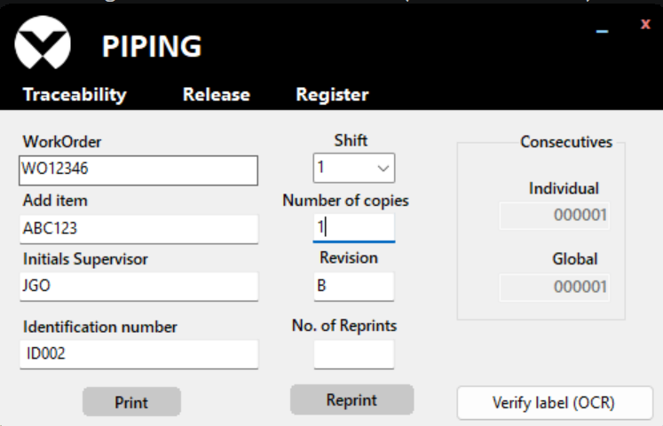

El tipo de estación lo configura el responsable técnico; el operador no lo cambia desde la app.

---

## 3. Pantalla principal

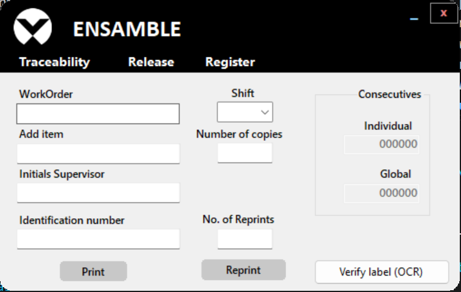

**Barra superior (negra):**
- A la izquierda, el logo y el **nombre del área** de la estación (por ejemplo, `PIPING`).
- A la derecha, **_** minimiza la ventana y **x** cierra la app.
- La ventana se mueve arrastrándola desde la franja superior.

**Barra de botones (debajo):**

| Botón | Qué hace |
|---|---|
| **Traceability** | Muestra la pantalla para imprimir etiquetas. Es la pantalla inicial |
| **Release** | Pide usuario y contraseña de QA y muestra la pantalla de liberación |
| **Register** | Pide usuario y contraseña de QA y abre la ventana para registrar un usuario nuevo |

**Cuadro *Consecutives*** (a la derecha, solo lectura):

| Campo | Qué muestra |
|---|---|
| **Individual** | Cuántas etiquetas ha impreso **esta estación** |
| **Global** | El último consecutivo usado en la base de datos. La siguiente etiqueta usará este número + 1 |

**Botón *Verify label (OCR)*** (esquina inferior derecha): verifica una etiqueta con la cámara o con una foto. Ver [sección 6](#6-verificar-una-etiqueta-verify-label-ocr).

---

## 4. Imprimir etiquetas (operador)

La impresión se manda directamente a la **impresora predeterminada de Windows**, sin abrir ningún cuadro de diálogo. Antes de empezar, confirma que la impresora de etiquetas sea la predeterminada.

### 4.1 Llenar los campos

En la pantalla **Traceability**:

1. **WorkOrder**: escribe la orden de trabajo.
2. **Add item**: escribe el item (número de parte). **Obligatorio.**
3. **Initials Supervisor**: escribe las iniciales del supervisor.
4. **Identification number**: escribe el número de identificación.
5. **Shift**: elige el turno (1 a 5).
6. **Revision** (solo en estaciones PIPING): escribe la revisión.
7. **Number of copies**: escribe cuántas etiquetas quieres. **Obligatorio.**

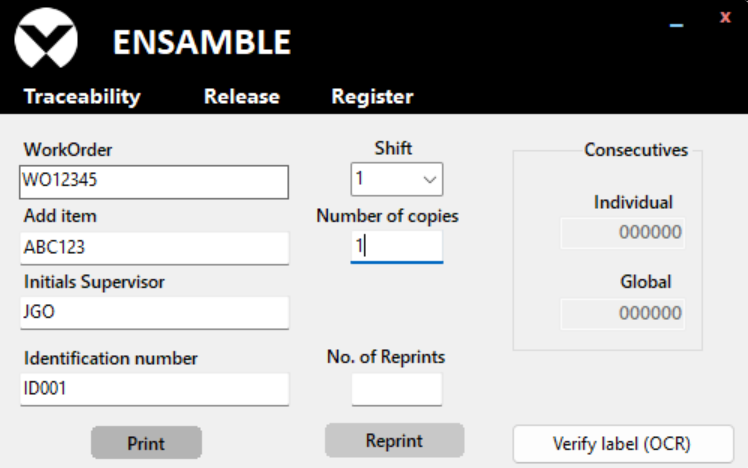

La app solo exige *Add item* y *Number of copies*, pero **llena todos los campos**: todos se imprimen en la etiqueta y se guardan en el registro.

### 4.2 Print

Pulsa **Print**. Pasa lo siguiente:

- Se imprimen tantas etiquetas como indicaste en *Number of copies*.
- **Cada etiqueta es distinta:** tiene su propio número de serie y su propio registro en la base de datos. Por ejemplo, con 3 copias salen tres seriales seguidos (`…000124`, `…000125`, `…000126`).
- Los contadores *Individual* y *Global* avanzan.
- Al terminar, los campos se borran para la siguiente captura.

### 4.3 Reprint y No. of Reprints

**Reprint** vuelve a imprimir con los datos de la **última impresión hecha en esta sesión** (desde que se abrió la app).

1. Escribe en **No. of Reprints** cuántas reimpresiones quieres.
2. Pulsa **Reprint**.

> **Importante: cada reimpresión genera un número de serie nuevo y un registro nuevo en la base de datos.** No es una copia idéntica de la etiqueta anterior: es una etiqueta nueva con los mismos datos. El contador *Global* avanza con cada reimpresión.

Ten en cuenta también:

- El turno (**Shift**) no se copia. Si quieres que salga en la reimpresión, elígelo antes de pulsar *Reprint*. Con más de una reimpresión, solo la primera lleva el turno.
- Si todavía no has impreso nada desde que abriste la app, *Reprint* imprime una etiqueta **vacía** (con serial nuevo). No lo uses en ese caso.

---

## 5. Liberación de calidad (QA)

La liberación se hace en la pantalla **Release**. Solo se pueden liberar o rechazar etiquetas que estén en estado **Impresa**.

### 5.1 Iniciar sesión

1. Pulsa **Release**.
2. Escribe tu **Usuario** y **Contraseña** (la contraseña se ve con puntos).
3. Pulsa **Ingresar**. Con **Cancelar** regresas sin entrar.

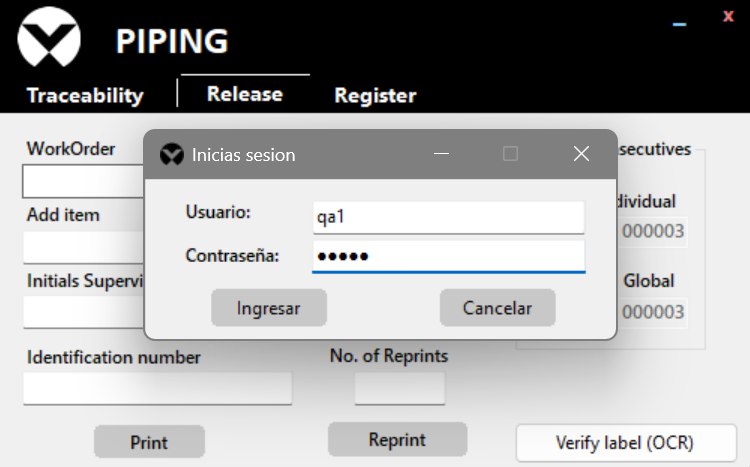

- Si el usuario o la contraseña no son correctos, aparece *"Usuario y/o contraseña incorrectos. Intente de nuevo."* y los campos se borran.
- Si todavía no hay ningún usuario registrado, aparece *"No hay usuarios registrados. Crea el primero con el botón Register."* Ver [sección 7](#7-registrar-usuarios-de-qa-register).
- El usuario no distingue mayúsculas de minúsculas; la contraseña sí.
- Cada vez que pasas de *Traceability* a *Release* se vuelve a pedir el inicio de sesión.

### 5.2 Search: buscar la etiqueta por serial

1. En **Serial**, escribe o escanea el número de serie de la etiqueta (por ejemplo `R26KS000123`). No importa si va en mayúsculas o minúsculas.
2. Pulsa **Search**.
3. Los campos **WorkOrder** e **Item** se llenan solos con lo registrado al imprimir. Están en gris porque no se pueden editar.

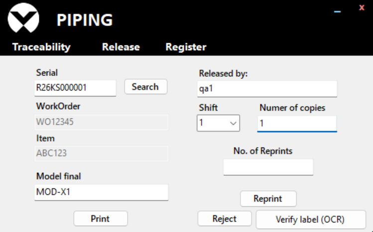

- Si la etiqueta ya está liberada o rechazada, aparece el aviso *"Etiqueta ya procesada"*. No podrás liberarla ni rechazarla.
- Si el serial no existe, aparece *"No se encontraron resultados para el serial proporcionado."*

### 5.3 Completar los datos de liberación

| Campo | Qué escribir |
|---|---|
| **Model final** | El modelo final. Se imprime en mayúsculas. Obligatorio |
| **Released by:** | Quién libera (tu nombre o usuario). Obligatorio. Es texto libre: la app no lo toma del inicio de sesión |
| **Shift** | El turno (1 a 5) |
| **Numer of copies** | Cuántas copias de la etiqueta de liberación quieres (1 o más). Obligatorio. *(En pantalla dice "Numer", así está escrito)* |

### 5.4 Print: liberar e imprimir

Pulsa **Print**. El orden es:

1. Primero la etiqueta se marca como **Liberada** en la base de datos. Si ya estaba liberada o rechazada, aparece un aviso y **no se imprime nada**.
2. Se imprimen las copias de la **etiqueta de liberación**.
3. Los campos se borran y aparece el mensaje *"Liberado con éxito"* con el serial liberado.

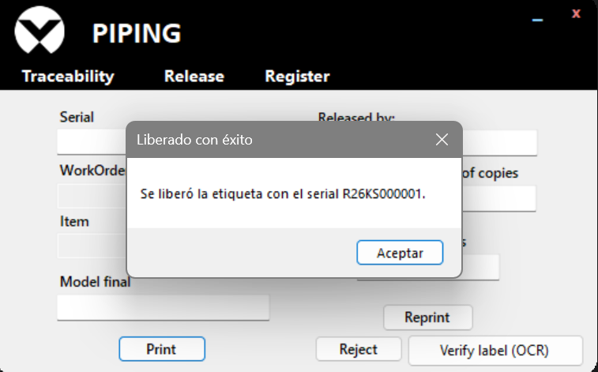

La etiqueta de liberación lleva el encabezado **"Calidad Liberacion"** (así, sin acento) y además: WO, Item, Modelo final, Fecha y hora, Turno, Liberado por, y el serial en código de barras y en texto. Todas las copias son idénticas.

### 5.5 Reject: rechazar la etiqueta

Usa **Reject** cuando la etiqueta no debe liberarse.

1. Busca la etiqueta con **Search** (recomendado, para confirmar que es la correcta).
2. Escribe en **Released by:** quién rechaza. Es obligatorio.
3. Pulsa **Reject**.
4. Confirma con **Sí** en la pregunta *"¿Marcar la etiqueta … como RECHAZADA? Después ya no se podrá liberar."*
5. Aparece *"La etiqueta … quedó marcada como RECHAZADA."* y los campos se borran.

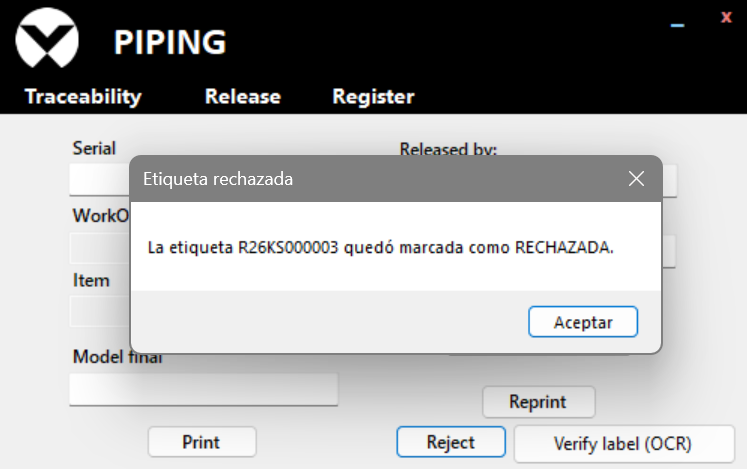

*Reject* **no imprime nada**. Una etiqueta rechazada ya no se puede liberar.

### 5.6 Reprint en Release

**Reprint** de la pantalla Release vuelve a imprimir la **última etiqueta de liberación impresa en esta sesión**, sin cambiar nada en la base de datos (la etiqueta ya está liberada).

1. Escribe en **No. of Reprints** cuántas copias quieres.
2. Pulsa **Reprint**.

Úsalo, por ejemplo, si la impresora falló al liberar: la etiqueta ya quedó liberada y solo falta la impresión. Si cierras la app, se pierde la "última liberación" y *Reprint* muestra *"Todavía no se ha impreso ninguna etiqueta de liberación en esta sesión."*

---

## 6. Verificar una etiqueta (Verify label (OCR))

La verificación lee la etiqueta impresa (códigos de barras y texto) y la compara con lo que se registró al imprimir. Sirve para detectar etiquetas equivocadas antes de liberarlas.

> **Verificar no libera la etiqueta.** El resultado es solo una recomendación. La liberación o el rechazo se hacen siempre en **Release** (ver [sección 5](#5-liberación-de-calidad-qa)).

### 6.1 Iniciar la verificación

1. Pulsa **Verify label (OCR)** (esquina inferior derecha).
2. La app pregunta *"¿Verificar la etiqueta con la cámara?"*:
   - **Sí**: usar la cámara.
   - **No**: elegir un archivo de imagen (`.png`, `.jpg`, `.jpeg` o `.bmp`).
   - **Cancelar**: no verificar.

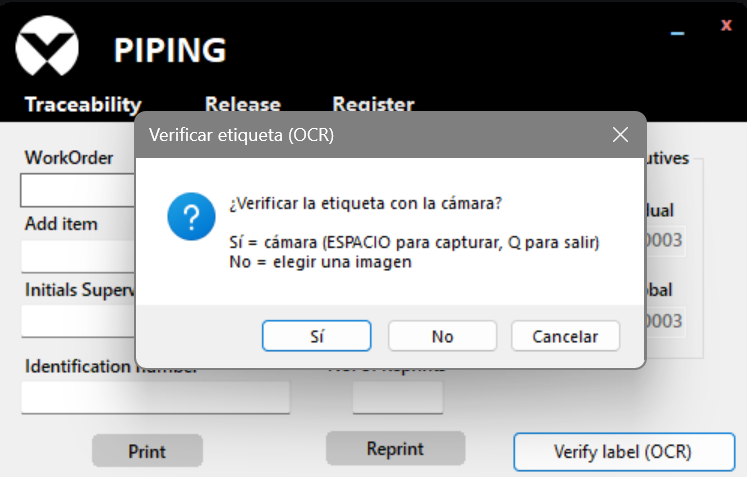

Mientras se verifica, el botón queda desactivado.

### 6.2 Con la cámara

1. Se abre la ventana **"Camara - etiqueta (ESPACIO = verificar, Q = salir)"** con la imagen en vivo.
2. Coloca la etiqueta frente a la cámara.
3. Pulsa **ESPACIO**. El sistema analiza durante unos segundos (hasta 8) y muestra *"Analizando… (manten la etiqueta quieta)"*. **No muevas la etiqueta.**
4. La ventana de la cámara se cierra y aparece el resultado.

Pulsa **Q** para salir sin verificar.

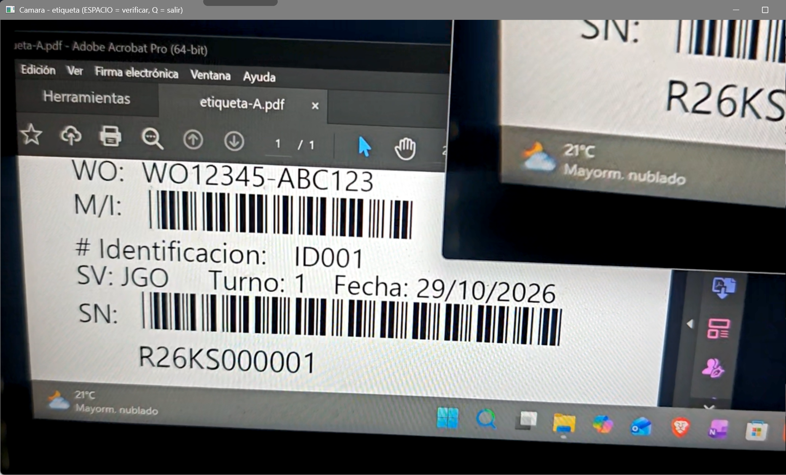

La foto analizada se guarda automáticamente en la carpeta de capturas de la estación.

### 6.3 Con un archivo de imagen

Elige la foto de la etiqueta en el cuadro *Abrir* y espera el resultado.

### 6.4 Consejos para una buena captura

- Buena luz, sin reflejos ni sombras sobre la etiqueta.
- La etiqueta completa, derecha y ocupando buena parte de la imagen.
- Quieta durante el análisis: una foto movida sale borrosa.
- Que se vean bien los dos códigos de barras (M/I y SN) y la línea de **WO**.
- Verifica la etiqueta **antes** de liberarla. Si ya está liberada, el resultado será RECHAZAR (ya fue procesada).

### 6.5 Ventana de resultado

Aparece la ventana **"Verificar etiqueta (OCR)"** con un encabezado de color y, debajo, el detalle. Ciérrala con **Aceptar**.

| Encabezado | Color | Significado | Qué hacer |
|---|---|---|---|
| **LIBERAR - etiqueta aprobada** | Verde | Todo lo leído coincide con lo registrado | Libérala en **Release** |
| **RECHAZAR - etiqueta no válida** | Rojo | Se leyó un dato y **no coincide**, o la etiqueta no se puede liberar | Sepárala y revisa el motivo. Si se confirma, recházala con **Reject** |
| **REVISIÓN MANUAL - revisa la etiqueta a simple vista** | Ámbar | No se pudo leer bien o hay algo sospechoso | Repite la captura o revisa la etiqueta tú mismo y decide en **Release** |
| **ERROR - no se pudo verificar** | Gris | La verificación no se pudo hacer (sin cámara, sin captura, falta un programa…) | Lee el detalle y ve la [sección 9](#9-mensajes-de-error-frecuentes-y-qué-hacer) |

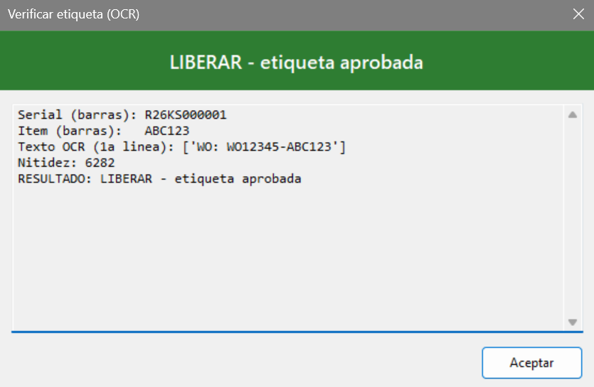

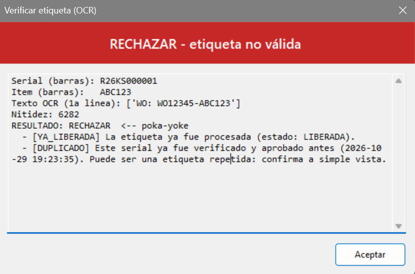

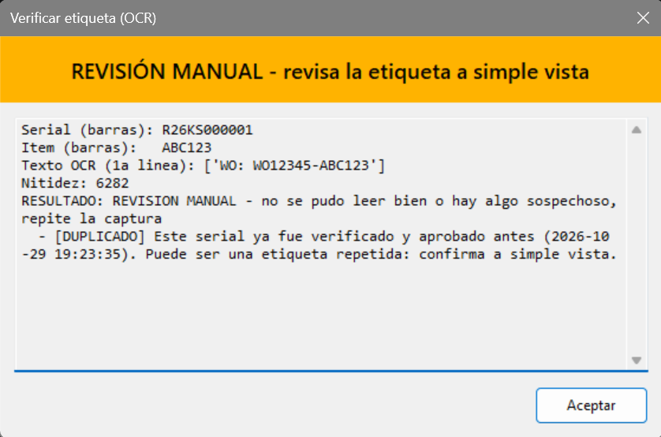

El detalle muestra lo que se leyó (serial e item de los códigos de barras, primera línea de texto, nitidez de la imagen) y la lista de motivos, cada uno con un código entre corchetes, por ejemplo `[WO_DUDOSO]`. Los motivos marcados como `(aviso)` son solo informativos y no cambian el resultado.

### 6.6 Motivos y qué hacer

| Código | Resultado | Qué significa | Qué hacer |
|---|---|---|---|
| `ILEGIBLE_FOTO` | Revisión manual | No se leyó el serial y la foto está borrosa | Repite con más luz y la etiqueta quieta |
| `ILEGIBLE_ETIQUETA` | Revisión manual | La foto es nítida pero no se leyó el serial | Acerca la etiqueta a la cámara. Si sigue igual, puede estar mal impresa: revísala a simple vista |
| `FORMATO_INVALIDO` | Rechazar | El serial leído no tiene el formato correcto (R + año + letra de mes + S + 6 dígitos) | La etiqueta no es válida. Sepárala y avisa a tu supervisor |
| `NO_EXISTE` | Rechazar | El serial no está registrado en la base de datos de esta estación | Confirma que la etiqueta se imprimió en esta estación. Si no, sepárala y avisa |
| `YA_LIBERADA` | Rechazar | La etiqueta ya fue liberada | No hace falta liberarla otra vez. Si es una etiqueta repetida, sepárala |
| `YA_RECHAZADA` | Rechazar | La etiqueta ya fue rechazada | No se puede usar. Sepárala |
| `DUPLICADO` | Revisión manual | Este serial ya se verificó antes con resultado LIBERAR | Puede haber dos etiquetas físicas con el mismo serial. Confírmalo a simple vista |
| `SALTO_SECUENCIA` | Aviso | Falta en la base el consecutivo anterior a este | Solo informa. Si es frecuente, avisa al supervisor |
| `SERIAL_FECHA_INCOHERENTE` | Revisión manual | El año o la letra del mes del serial no corresponden a la fecha de impresión | Revisa la etiqueta y avisa al supervisor |
| `ITEM_ILEGIBLE` | Revisión manual | No se pudo leer el item (M/I) | Repite la captura con el código M/I bien visible |
| `ITEM_NO_COINCIDE` | Rechazar | El item de la etiqueta no es el registrado | Etiqueta equivocada: sepárala |
| `WO_ILEGIBLE` | Revisión manual | No se pudo leer la orden de trabajo | Repite la captura con la línea WO bien visible |
| `WO_NO_COINCIDE` | Rechazar | La orden de trabajo impresa es distinta de la registrada | Etiqueta equivocada: sepárala |
| `WO_DUDOSO` | Revisión manual | La WO leída se parece a la registrada pero no es igual | Puede ser un error de lectura. Compárala a simple vista |
| `REVISION_NO_COINCIDE` | Rechazar | La revisión (Rv) impresa es distinta de la registrada | Etiqueta equivocada: sepárala |
| `FECHA_INCOHERENTE` | Aviso | La fecha leída no coincide con la de impresión | Solo informa (la lectura de números es poco fiable) |

Si hay varios motivos, gana el más grave: cualquier motivo de **Rechazar** da RECHAZAR; si no hay ninguno, cualquier motivo de **Revisión manual** da REVISIÓN MANUAL; si solo hay avisos o ninguno, el resultado es LIBERAR.

---

## 7. Registrar usuarios de QA (Register)

Los usuarios de QA son los que pueden entrar a **Release** y registrar a otros usuarios.

### 7.1 Primer usuario

Si todavía no hay ningún usuario, al pulsar **Register** aparece *"No hay usuarios registrados. Crea el primer usuario de QA."* y se abre directamente la ventana de registro, sin pedir inicio de sesión.

### 7.2 Usuarios siguientes

1. Pulsa **Register**.
2. Inicia sesión con un **usuario de QA que ya exista** (igual que en la [sección 5.1](#51-iniciar-sesión)).
3. Se abre la ventana **"Registrar de personal"**.

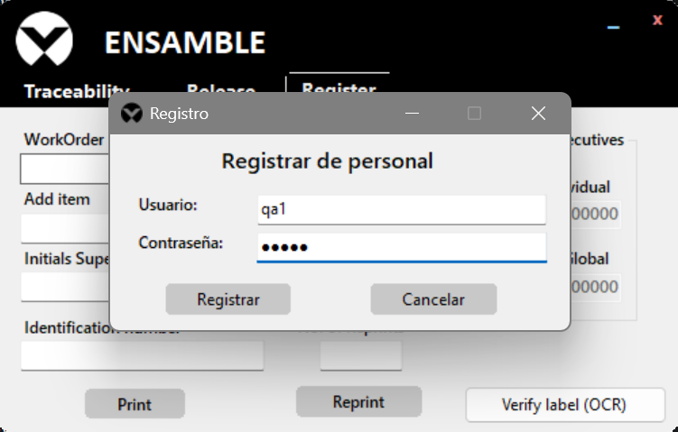

### 7.3 Registrar

1. Escribe el **Usuario** y la **Contraseña**. Los dos deben tener **de 3 a 8 caracteres**.
2. Pulsa **Registrar**. Con **Cancelar** sales sin registrar.

| Mensaje | Qué significa |
|---|---|
| *"Registro guardado correctamente."* | El usuario se creó. La ventana se cierra |
| *"El usuario … ya existe."* | Ese nombre ya está registrado (sin importar mayúsculas). Elige otro |
| *"El usuario y la contraseña deben tener entre 3 y 8 caracteres."* | Ajusta la longitud |

La app no tiene opciones para borrar usuarios ni cambiar contraseñas. Si lo necesitas, pídelo al responsable técnico.

---

## 8. Estación de Embarques

En las estaciones configuradas como **EMBARQUES**, la app muestra la pantalla de etiquetas de embarque en lugar de la de trazabilidad. Los botones *Traceability*, *Release* y *Register* no aparecen.

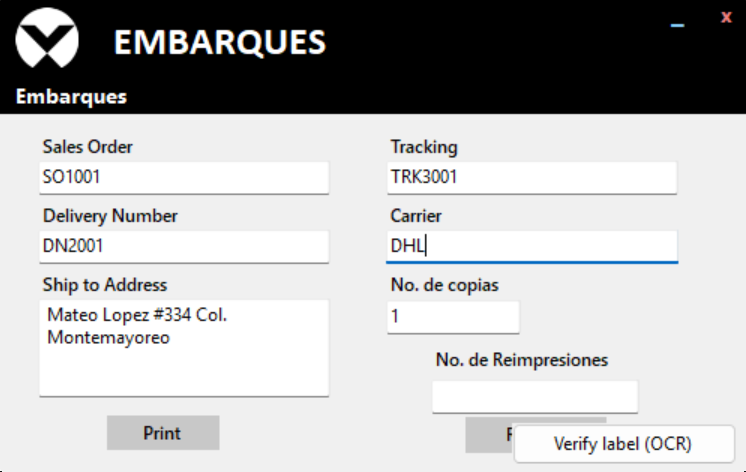

La etiqueta de embarque **no genera número de serie ni se guarda en la base de datos**.

### 8.1 Imprimir

1. Llena todos los campos (los cinco son obligatorios):
   - **Sales Order**: orden de venta.
   - **Delivery Number**: número de entrega.
   - **Ship to Address**: dirección de envío. Admite varias líneas; en la etiqueta se corta cada 33 caracteres.
   - **Tracking**: número de rastreo.
   - **Carrier**: transportista.
2. En **No. de copias**, escribe cuántas copias quieres.
3. Pulsa **Print**.

Todas las copias son idénticas. Al terminar, los campos se borran. Si falta algún campo aparece *"Complete todos los campos."*

La etiqueta lleva los cinco datos en texto grande. Sales Order, Delivery Number, Tracking y Carrier llevan además su código de barras.

### 8.2 Reimprimir

1. Escribe en **No. de Reimpresiones** cuántas copias quieres.
2. Pulsa **Reprint**.

Se reimprime la última etiqueta de embarque de **esta sesión**. Si todavía no has impreso ninguna desde que abriste la app, la etiqueta sale vacía.

---

## 9. Mensajes de error frecuentes y qué hacer

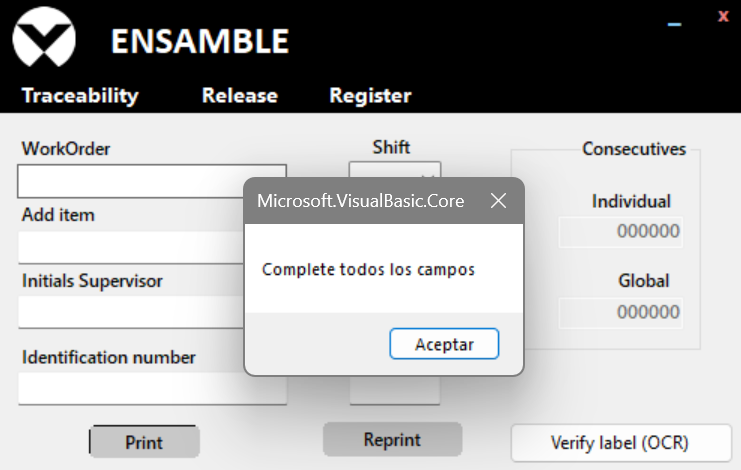

| Mensaje | Dónde | Qué hacer |
|---|---|---|
| *"Complete todos los campos"* | Print en Traceability, Release o Embarques | Llena los campos obligatorios. En Release, primero haz **Search** para llenar WorkOrder e Item |
| *"Ingrese un número válido en TextBox10."* | Print en Traceability | Escribe un número entero en *Number of copies* |
| *"Ingresa una cantidad válida."* | Reprint en Traceability | Escribe un número entero en *No. of Reprints* |
| *"Ingrese un número válido."* | Print en Release | Escribe un número de 1 o más en *Numer of copies* |
| *"Ingresa un valor valido"* | Reprint en Release | Escribe un número de 1 o más en *No. of Reprints* |
| *"Ingrese un número válido para la cantidad."* | Embarques | Escribe un número entero en el campo de copias |
| *"Por favor, ingresa un serial antes de realizar la búsqueda."* | Search | Escribe el serial |
| *"No se encontraron resultados para el serial proporcionado."* | Search | Revisa que el serial esté bien escrito y que se haya impreso en esta estación |
| *"La etiqueta … ya está LIBERADA/RECHAZADA. No se puede liberar ni rechazar de nuevo."* | Search, Print o Reject en Release | La etiqueta ya fue procesada. No hay nada más que hacer con ella |
| *"El serial … no existe en la base de datos."* | Print o Reject en Release | Revisa el serial |
| *"Escribe el serial y quién rechaza (Released by)."* | Reject | Llena *Serial* y *Released by:* |
| *"Todavía no se ha impreso ninguna etiqueta de liberación en esta sesión."* | Reprint en Release | Solo se puede reimprimir una liberación hecha desde que abriste la app |
| *"Usuario y/o contraseña incorrectos. Intente de nuevo."* | Inicio de sesión | Revisa usuario y contraseña (la contraseña distingue mayúsculas) |
| *"No hay usuarios registrados…"* | Inicio de sesión o Register | Crea el primer usuario con **Register** |
| *"Error al almacenar los datos en la base de datos: …"* | Print en Traceability | **La etiqueta se imprimió pero no quedó registrada.** Sepárala, no la uses y avisa al responsable técnico |
| *"Error al cargar los valores desde la base de datos: …"* o cualquier otro *"Error al … base de datos"* | Al abrir la app o al imprimir | Avisa al responsable técnico |
| *"El archivo Spot.txt no existe."* | Al abrir la app | Avisa al responsable técnico (falta la configuración de la estación) |
| Encabezado gris **ERROR** con *"No se encontró Python…"* o *"no se encontro Tesseract OCR"* | Verify label (OCR) | Falta software en la computadora. Avisa al responsable técnico |
| **ERROR** con *"No se pudo abrir la camara."* | Verify label (OCR) | Revisa que la cámara esté conectada y que no la esté usando otro programa |
| **ERROR** con *"No se capturo ninguna etiqueta."* | Verify label (OCR) | Saliste con **Q** sin pulsar ESPACIO. Vuelve a intentarlo |
| **ERROR** con *"No se pudo abrir la imagen."* | Verify label (OCR) | El archivo no es una imagen válida. Elige otro |

---

## 10. Buenas prácticas

- **Una etiqueta por pieza.** Usa *Number of copies* con el número exacto de etiquetas que necesitas: cada una lleva un serial distinto.
- **Evita reimprimir en Traceability.** Cada *Reprint* crea un serial y un registro nuevos. Si una etiqueta salió mal, apártala y avisa a QA para que la rechace con **Reject**.
- **Llena todos los campos**, aunque la app solo exija algunos.
- Escribe la orden de trabajo y el item **en mayúsculas**, tal como vienen en la orden. El código de barras de la etiqueta (Code 39) solo codifica mayúsculas, números y algunos signos.
- **Revisa la impresora predeterminada** antes de imprimir: la app no pregunta a qué impresora mandar.
- **Verifica antes de liberar:** imprime → verifica con *Verify label (OCR)* → si sale LIBERAR, libera en *Release*.
- Si la verificación sale **REVISIÓN MANUAL**, revisa la etiqueta a simple vista antes de decidir. Si sale **RECHAZAR**, aparta la etiqueta.
- **No compartas tu contraseña** de QA y escribe tu propio nombre en *Released by:*.
- **Cierra la sesión de Release** cuando termines: pulsa *Traceability* para volver a la pantalla de impresión. La próxima vez que alguien entre a *Release* se pedirá usuario y contraseña.
- **No abras ni edites los archivos de configuración** de la estación (por ejemplo `No_borrar_ni_abrir.txt`).

---

## 11. Glosario

| Término | Significado |
|---|---|
| **WO** | *Work Order*, orden de trabajo |
| **M/I** | El item (número de parte) de la pieza. En la etiqueta va como código de barras |
| **SV** | Supervisor. En la etiqueta van sus iniciales |
| **Rv** | Revisión. Solo en estaciones PIPING |
| **SN** | *Serial Number*, número de serie de la etiqueta |
| **QA** | *Quality Assurance*, aseguramiento de calidad. Es quien libera o rechaza |
| **Poka-yoke** | Mecanismo a prueba de errores. Aquí: la verificación que rechaza una etiqueta cuando un dato leído no coincide con lo registrado |
| **Consecutivo global** | Número que va al final del serial. Sube en 1 con cada etiqueta registrada en la base de datos |
| **Consecutivo individual** | Cuenta de etiquetas impresas en esta estación |
| **Liberar** | Aprobar una etiqueta por calidad e imprimir su etiqueta de liberación |
| **Rechazar** | Marcar una etiqueta como no válida. Ya no se podrá liberar |
